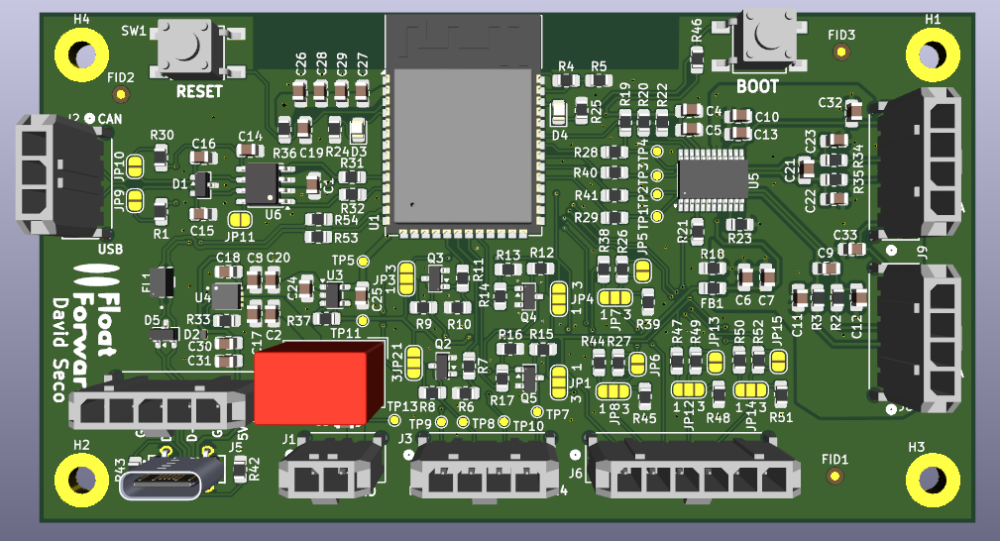
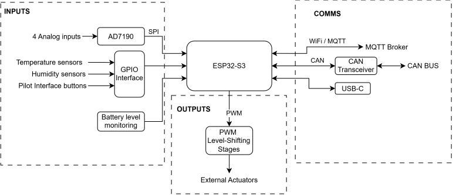
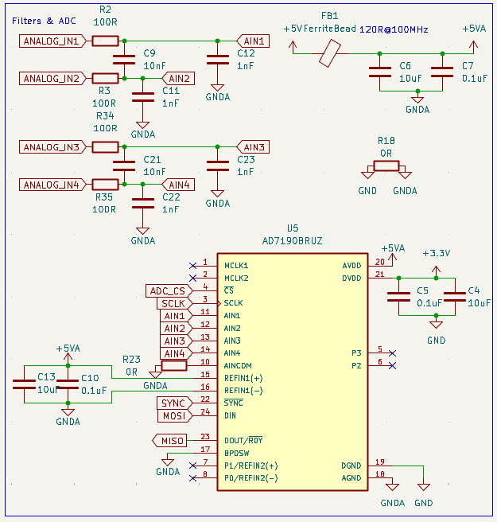
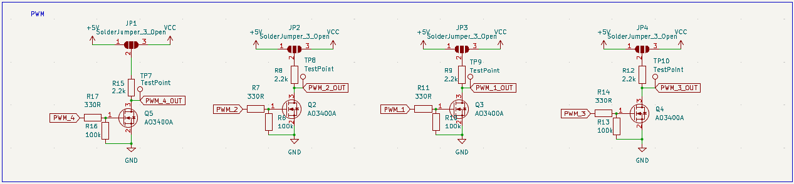
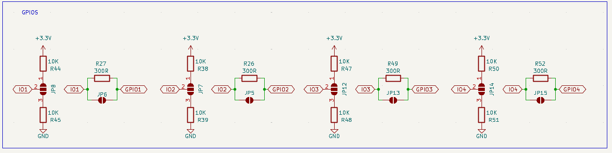
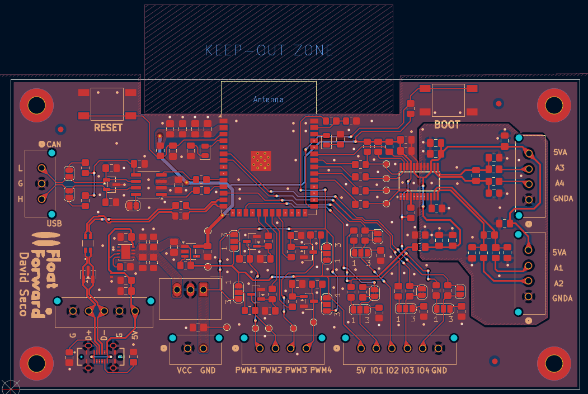

# DTU Float Forward — Embedded Control Unit

Custom embedded control unit developed for the **DTU Float Forward electric racing boat**.

The ECU integrates sensing, actuator control, CAN communication and wireless telemetry around an **ESP32-S3**, providing a compact hardware platform for onboard monitoring and auxiliary control.

This repository documents the second hardware revision of the ECU, developed as an evolution of an earlier ESP32-S3 development-board prototype.

## Project Context

The ECU was developed as part of **DTU Float Forward**, DTU's electric racing boat project for the Monaco Energy Boat Challenge.

The project combines embedded systems, electric propulsion, sensing, telemetry and energy-management development in a competition marine environment.

## My Contribution

I was responsible for the complete design of the ECU presented in this repository, from the system architecture and component selection to schematic design and PCB layout.

## Repository Scope

This repository is intended as a **technical portfolio and design case study**.

It provides an overview of the ECU architecture and selected design decisions while intentionally excluding the complete implementation and manufacturing package.

The following files are therefore **not publicly distributed**:

* complete schematics
* KiCad source files
* PCB layout source
* Gerber and manufacturing files
* complete BOM
* production firmware

Selected schematic excerpts are included only where they help illustrate specific engineering decisions.

## Overview

The ECU is designed as a general-purpose embedded node for the boat, combining data acquisition, communication and auxiliary control in a single board.

Its main functions include:

* ESP32-S3 based processing and control
* Four-channel high-resolution analog acquisition
* CAN bus communication
* Four configurable PWM outputs for external actuators
* Four configurable auxiliary GPIO interfaces with support for external temperature and humidity sensor monitoring
* Low-voltage battery monitoring
* Native USB programming and debugging
* Wi-Fi / MQTT telemetry

## System Architecture

The **ESP32-S3** acts as the central controller.

Low-level analog measurements are acquired through an external **AD7190 24-bit sigma-delta ADC**, while the CAN interface connects the ECU to the boat communication network.

Additional GPIO interfaces are used for external sensors and pilot-interface signals, while configurable PWM output stages provide control signals for auxiliary actuators such as cooling devices.

Telemetry data can be transmitted through Wi-Fi using MQTT.

## Hardware Design Highlights

### High-Resolution Analog Acquisition

Low-level sensor acquisition is handled by an external **AD7190** rather than relying exclusively on the ESP32-S3 internal ADC.

The analog front-end provides four external inputs and includes:

* RC input filtering for high-frequency noise attenuation
* filtered analog power supply
* local decoupling
* controlled connection between analog and digital ground domains
* SPI communication with the ESP32-S3

The architecture was designed for low-level measurements in the electrically noisy environment of an electric drivetrain.

### Configurable PWM Output Stages

Four configurable PWM output stages interface the 3.3 V ESP32-S3 logic with external actuators and control inputs.

Each channel uses an N-channel MOSFET as an open-drain-style output stage. A three-pad solder bridge allows the output pull-up voltage to be selected during assembly, making the same hardware compatible with different external voltage requirements.

The stages intentionally invert the PWM logic, which is handled in firmware.

### Configurable GPIO Interfaces

Four auxiliary GPIO channels were designed to support different external sensors, buttons and digital interfaces without requiring PCB modifications.

Each channel provides assembly-time configuration through solder bridges:

* selectable pull-up or pull-down bias
* series resistance for basic input protection
* optional bypass of the series resistor

This allows the same PCB to be adapted to different external devices during system integration.

### PCB Layout

The PCB was organised by functional area, with particular attention to the noise-sensitive analog acquisition section, external interface accessibility and the ESP32-S3 antenna keepout.

## Additional Design Decisions

### Integrated ESP32-S3

The first prototype used an ESP32-S3 development board to enable rapid firmware development and system validation.

For the second revision, the development board was replaced by an **ESP32-S3-WROOM module directly integrated into the PCB**, reducing external wiring and allowing the complete ECU to be designed around the application requirements.

### CAN Interface

The CAN physical layer is integrated directly on the board using a 3.3 V CAN transceiver.

The interface includes:

* ESD protection on the external bus
* configurable split termination
* assembly-time termination selection through solder bridges

This allows the ECU to operate either as an intermediate CAN node or as a terminated node at one end of the bus.

### Native USB Interface

The ESP32-S3 native USB interface is used for firmware programming and debugging without requiring an external USB-to-UART converter.

The board provides a USB-C interface together with protection and filtering components for connection to the microcontroller.

### Power Architecture

The ECU contains its own onboard power regulation.

The design supports both the normal external ECU supply and USB power during development, allowing the board electronics to be programmed and tested without powering the complete boat electrical system.

Local 5 V and 3.3 V rails supply the analog, digital and communication circuitry.

### Battery Monitoring

The low-voltage battery is monitored through a dedicated resistive divider connected to an analog-capable ESP32-S3 input.

This provides an independent measurement of the auxiliary battery voltage for onboard monitoring and telemetry.

## Development

The ECU was developed through an iterative prototyping process.

### Revision 1 — Functional Prototype

The initial system was built around an ESP32-S3 development board.

This version was used to develop and validate the main embedded architecture, including sensor acquisition, CAN communication, actuator control and telemetry.

### Revision 2 — Integrated ECU

The second revision replaces the development board with an ESP32-S3-WROOM module integrated directly onto the PCB.

The redesign also integrates and refines the:

* CAN physical layer
* native USB programming interface
* onboard power architecture
* analog acquisition front-end
* PWM output stages
* configurable GPIO interfaces
* battery monitoring circuit
* assembly-time configuration options

Revision 2 has completed the PCB design stage but **has not yet been manufactured or hardware-validated**.

## Firmware

The ECU firmware is developed using **ESP-IDF** and follows a modular architecture that separates hardware drivers from application-level functionality.

Firmware functionality associated with the ECU includes:

* AD7190 acquisition
* cooling-system control
* battery monitoring
* temperature and humidity acquisition
* CAN communication
* network time synchronisation
* MQTT telemetry

The complete boat firmware is not included in this repository. Reusable hardware drivers may be published separately as standalone projects.

## Documentation

More details about the hardware development are available here:

- [Design Decisions](docs/design_decisions.md)
- [Development History](docs/development.md)